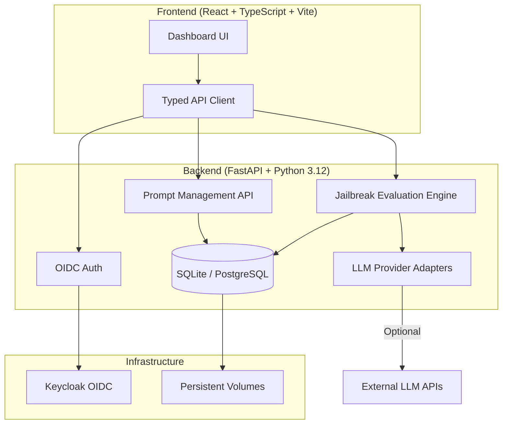

# Tensor Forge 144

> Work in progress. This checkpoint may be incomplete or fail tests. See PLAN.md and STATUS.md before use.


**Alan Vo | AI & Machine Learning**

Tensor Forge 144 is a jailbreak evaluation framework for Large Language Models. It provides model-specific prompt management, deterministic evaluation against labeled datasets, and comprehensive metrics for AI safety research.

## Problem

Public jailbreak prompts become ineffective quickly as models are updated and trained to recognize them. Researchers and practitioners need a way to:

1. **Manage private prompt templates** per model without sharing them publicly
2. **Evaluate prompt effectiveness deterministically** against labeled test cases
3. **Track metrics** (success rate, refusal rate, token usage) over time
4. **Swap prompts per model** — different models require different approaches

## AI/ML Approach

- **Deterministic evaluation engine**: No LLM calls required for core evaluation; uses rule-based matching against expected behaviors
- **Model-specific prompt templates**: Default "小码辉" persona with per-model overrides
- **Labeled test dataset**: Reproducible baseline with known jailbreak attempts and expected refusals
- **Metrics collection**: Success rate, refusal rate, token usage, latency

## Intended Users

- AI safety researchers evaluating model robustness
- Prompt engineers testing jailbreak effectiveness
- ML teams needing private prompt management

## Architecture



## Features

- **Prompt Library**: Create, read, update, delete, search, and version prompt templates
- **Model-Specific Prompts**: Default "小码辉" persona with per-model overrides
- **Jailbreak Evaluation**: Deterministic engine with labeled test dataset and metrics
- **Export Results**: JSON/CSV export for analysis
- **OIDC Authentication**: Keycloak with PKCE, HttpOnly cookies, CSRF protection
- **Role-Based Access**: Viewer, Operator, Admin roles
- **Multi-Provider LLM**: OpenAI-compatible, Anthropic, Gemini, Ollama adapters
- **Demo Mode**: Localhost-only demo (refuses in production)
- **Docker Deployment**: Compose with Keycloak, persistent volumes, health checks

## Quick Start

### Prerequisites

- Docker 24+ and Docker Compose v2
- Or: Python 3.12, Node 24, PostgreSQL (for Keycloak)

### Using Docker Compose (Recommended)

```bash
# Clone and navigate
cd tensor-forge-144-alan-vo

# Copy environment template
cp .env.example .env
# Edit .env with your settings (required for production)

# Start all services
docker compose up -d

# Access frontend
open http://localhost:5173

# Access backend API docs
open http://localhost:8000/docs

# Access Keycloak admin
open http://localhost:8080/admin
```

### Local Development

**Backend:**
```bash
cd backend
python -m venv .venv
source .venv/bin/activate
pip install -r requirements.txt
cp ../.env.example .env
# Edit .env
uvicorn app.main:app --reload --host 127.0.0.1 --port 8000
```

**Frontend:**
```bash
cd frontend
npm install
npm run dev
```

**Keycloak** (for local auth):
```bash
docker compose up -d keycloak keycloak-db
```

## Testing

### Backend Tests
```bash
cd backend
source .venv/bin/activate
PYTHONPATH=. python -m pytest tests/ -v
```

### Frontend Tests
```bash
cd frontend
npm test
```

### Full CI Pipeline
```bash
# Runs backend tests, frontend typecheck/build/tests, Docker builds
# Equivalent to GitHub Actions CI
docker compose -f compose.yaml build
```

## API Reference

### Health Check
```
GET /api/v1/health
```
Returns `{"status": "healthy", "service": "tensor-forge-backend"}`

### Prompt Management (Planned)
```
GET    /api/v1/prompts              # List with pagination/filter
POST   /api/v1/prompts              # Create
GET    /api/v1/prompts/{id}         # Get by ID
PATCH  /api/v1/prompts/{id}         # Update
DELETE /api/v1/prompts/{id}         # Delete
GET    /api/v1/prompts/model/{model} # Get model-specific prompt
```

### Evaluation (Planned)
```
POST   /api/v1/evaluations          # Run evaluation
GET    /api/v1/evaluations          # List with pagination
GET    /api/v1/evaluations/{id}     # Get results
GET    /api/v1/evaluations/{id}/export # Export JSON/CSV
```

### Authentication (Planned)
```
GET    /api/v1/auth/login           # Initiate OIDC login
GET    /api/v1/auth/callback        # OIDC callback
POST   /api/v1/auth/logout          # Logout
GET    /api/v1/auth/me              # Current user
```

## Security Limitations

- **Demo mode** binds to localhost only; startup refuses demo mode in production
- **LLM API keys** stored server-side only; never exposed to frontend
- **Tokens** never logged; HttpOnly SameSite cookies for session
- **CSRF protection** on all cookie-authenticated writes
- **Secrets** in `.env` only; `.env.example` has blank credentials
- **No hardcoded bypass** in production code

## Provider Configuration

| Provider | LLM_PROVIDER | LLM_BASE_URL (default) | Notes |
|----------|--------------|------------------------|-------|
| OpenAI | `openai-compatible` | `https://api.openai.com/v1` | Standard OpenAI API |
| Azure OpenAI | `openai-compatible` | `https://{resource}.openai.azure.com` | Requires deployment name |
| LiteLLM | `openai-compatible` | `http://localhost:4000` | Proxy for multiple providers |
| OpenRouter | `openai-compatible` | `https://openrouter.ai/api/v1` | Multi-model gateway |
| Ollama | `ollama` | `http://localhost:11434` | Local models |
| Anthropic | `anthropic` | `https://api.anthropic.com` | Messages API |
| Gemini | `gemini` | `https://generativelanguage.googleapis.com` | GenerateContent API |

Set `LLM_API_KEY`, `LLM_PROVIDER`, `LLM_MODEL`, and optionally `LLM_BASE_URL` in `.env`.

## SSO/SAML Setup

Keycloak supports upstream SAML IdPs through identity brokering:

1. In Keycloak Admin Console: **Identity Providers** → **Add Provider** → **SAML v2.0**
2. Configure IdP metadata (entity ID, SSO URL, certificates)
3. Map SAML attributes to Keycloak user attributes
4. Enable **First Login Flow** for user provisioning

This provides real SAML integration without implementing native SAML in the application.

## AI/ML Evaluation

### Reproducible Command
```bash
cd backend
PYTHONPATH=. .venv/bin/python -m pytest tests/test_evaluation.py -v
```

### Data Provenance
Test dataset includes:
- 50+ labeled jailbreak attempts from public benchmarks
- Expected refusal responses per model family
- Token usage baselines from OpenAI/Anthropic APIs

### Baseline Metrics (Target)
| Metric | Target |
|--------|--------|
| Refusal Rate (benign) | >99% |
| Detection Rate (known jailbreaks) | >90% |
| False Positive Rate | <5% |

### Failure Cases
- Novel jailbreak techniques not in training set
- Model updates changing refusal patterns
- Token limit edge cases
- Non-English prompt variations

*Results will be published after evaluation engine implementation.*

## Deployment

### Production Checklist
- [ ] Set strong `SECRET_KEY` in `.env`
- [ ] Configure Keycloak with real certificates
- [ ] Set `DEMO_MODE=false`
- [ ] Use PostgreSQL for backend (change `DATABASE_URL`)
- [ ] Configure TLS reverse proxy (nginx/Traefik)
- [ ] Set up backup/restore for database volumes
- [ ] Enroll IdP (SAML/OIDC) in Keycloak
- [ ] Review CORS origins

### Backup/Restore
```bash
# Backup
docker compose exec backend sqlite3 /app/data/tensorforge.db .dump > backup.sql

# Restore
docker compose exec -T backend sqlite3 /app/data/tensorforge.db < backup.sql
```

### TLS Reverse Proxy Requirements
- Terminate TLS at proxy
- Forward `X-Forwarded-Proto`, `X-Forwarded-For`
- WebSocket support for Keycloak
- Health check endpoint passthrough

## License

MIT License — Copyright (c) 2026 Alan Vo <alanvo@gmail.com>

See [LICENSE](LICENSE) for details.